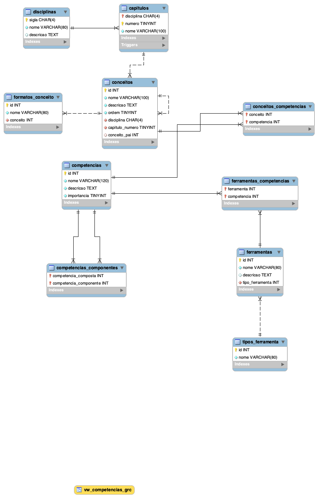

# Base de dados de conteúdos programáticos: Grafos e Redes Complexas

Projeto da unidade curricular de Bases de Dados e Gestão de Informação (Licenciatura em Matemática Aplicada e Tecnologias Digitais, Iscte, 2025/26).

É uma base de dados relacional em MySQL que organiza o programa de uma disciplina: capítulos, conceitos e subconceitos, as competências que cada conceito desenvolve e as ferramentas usadas (por exemplo, Python e NetworkX). Usámos como caso a disciplina de Grafos e Redes Complexas.

## O que tem

- **Modelo conceptual em UML** (`diagramas_uml.mdj`, abre no StarUML), convertido depois para o modelo relacional.
- **10 tabelas** com chaves primárias e estrangeiras e restrições de integridade (`CHECK`, `UNIQUE`, `ON DELETE CASCADE`):
  - tabelas associativas para as relações muitos-para-muitos;
  - relações recursivas para os subconceitos e para as competências compostas.
- **Dados incluídos no próprio script**, para a base de dados correr em qualquer máquina sem ficheiros externos.
- **Consultas:**
  - Q1 a Q5 são as consultas do enunciado, por exemplo competências por disciplina e conceitos por capítulo.
  - Q6 a Q8 são consultas nossas, com junções, `GROUP BY` e uma subconsulta.
- **Uma vista**, `vw_competencias_grc`.
- **Uma função**, `tipo_competencia`, que classifica uma competência como de conceito, de ferramenta ou mista.
- **Um procedimento**, `registar_competencia_mista`, que cria uma competência nova a partir de duas existentes e regista as componentes.
- **Um trigger**, `preencher_numero_capitulo`, que numera automaticamente um capítulo novo.

## Como correr

No MySQL Workbench (ou noutro cliente MySQL 8), abre `projeto_grc.sql` e executa o script inteiro. O script cria a base de dados `projeto_grc` de raiz e, no fim de cada secção, tem os testes das consultas, da função, do procedimento e do trigger.

## Autoras

Inês Ferreira e Maria Madalena Brás.
